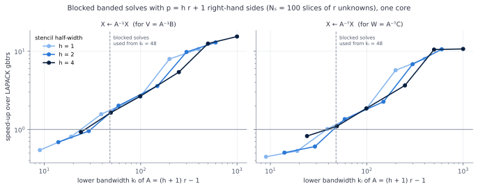
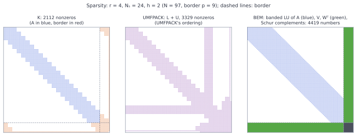
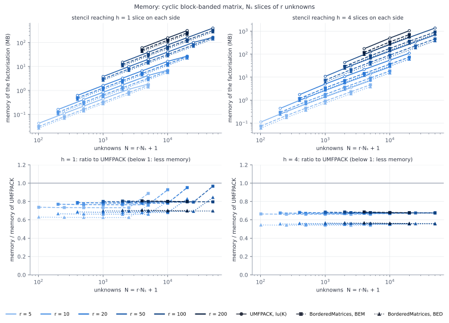
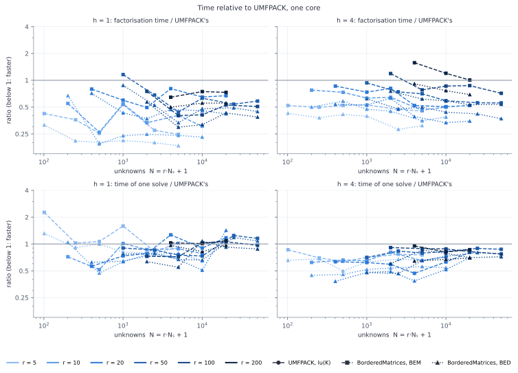

<p align="center">
  
</p>

# BorderedMatrices.jl

Direct solution of bordered linear systems

```math
\begin{bmatrix} A & B \\ C^\top & D \end{bmatrix}
\begin{bmatrix} x \\ y \end{bmatrix}
=
\begin{bmatrix} f \\ g \end{bmatrix},
\qquad
A \in \mathbb{F}^{n\times n},\quad
B,\ C \in \mathbb{F}^{n\times p},\quad
D \in \mathbb{F}^{p\times p},\quad
\mathbb{F} = \mathbb{R} \text{ or } \mathbb{C},
```

by block elimination, reusing a factorisation of the large block $A$. The border
is usually thin, $p \ll n$.

Systems of this form appear wherever a large structured operator is augmented by
a few dense rows and columns: Newton methods for periodic orbits (the period as
an extra unknown, a phase condition as an extra equation), pseudo-arclength
continuation, Lagrange multipliers. Keeping the border separate lets $A$ be
factorised by a solver that exploits its structure, which the dense border would
otherwise destroy.

**Contents**

* two elimination algorithms: mixed block elimination (BEM, stable when $A$ is
  nearly singular) and plain block elimination (BED);
* any factorisation of $A$ that supports `ldiv!` with the matrix and its
  transpose: dense, sparse (UMFPACK), or banded;
* `BandedMatrix`, a banded matrix in LAPACK storage, whose LU solves many
  right-hand sides at once by blocks, 10–15 times faster than LAPACK's `gbtrs`;
* `blockcyclic`, which assembles a cyclic block-banded matrix (e.g. a
  time-periodic operator) directly as a bordered matrix with a banded $A$;
* real and complex matrices; solves that do not allocate;
* no dependencies other than LinearAlgebra.

The package is meant for direct linear algebra on stored arrays: every block is
a matrix and every part of a vector is a vector, all with the same element type.

## Quick start

```julia
using BorderedMatrices, LinearAlgebra, SparseArrays

n, p = 1000, 2
A = sprand(n, n, 0.01) + 10I
M = BorderedMatrix(A, rand(n, p), rand(n, p), zeros(p, p))   # [A B; Cᵀ D]

F = lu(M)                                  # lu(A) (here UMFPACK), then BEM
r = BorderedVector(rand(n), rand(p))       # [f; g]
z = F \ r                                  # z.x = x, z.y = y
ldiv!(F, r)                                # or in place
```

## Algorithms

Eliminating $x$ gives the $p \times p$ Schur complement:

```math
S = D - C^\top A^{-1} B ,
\qquad
S\, y = g - C^\top A^{-1} f ,
\qquad
A\, x = f - B\, y .
```

There are two ways of organising this computation.

**BED, plain block elimination** (`alg = :BED`). With $W = A^{-\top} C$,

```math
y = \left(D - W^\top B\right)^{-1} \left(g - W^\top f\right),
\qquad
x = A^{-1}\left(f - B\,y\right).
```

It is cheap, but inaccurate when $A$ is nearly singular, even if the bordered
matrix itself is well conditioned: $W$ is then huge and $g - W^\top f$ suffers
from cancellation.

**BEM, mixed block elimination** (`alg = :BEM`, the default; Govaerts and
Pryce). A first pass as BED gives $y_1$; the residual of the bordered system is
then solved again with the second form of the Schur complement, built from
$V = A^{-1} B$:

```math
\begin{aligned}
y_1 &= \left(D - W^\top B\right)^{-1}\left(g - W^\top f\right), \\
f_1 &= f - B\,y_1, \qquad g_1 = g - D\,y_1, \\
\xi &= A^{-1} f_1, \\
y_2 &= \left(D - C^\top V\right)^{-1}\left(g_1 - C^\top \xi\right), \\
x &= \xi - V\,y_2, \qquad y = y_1 + y_2 .
\end{aligned}
```

In exact arithmetic $y_2 = 0$; in floating point the second pass removes the
error of the first. BEM is stable when $A$ is nearly singular, which is the usual
situation when the border is precisely what makes the system nonsingular: at a
periodic orbit, for example, the time-translation direction is in the kernel of
$A$ and the phase condition removes it.

`lu` computes $W$, $V$ (BEM only) and the LU factors of the $p \times p$ Schur
complements **once**. Each solve then costs a single solve with $A$, plus
$O(np)$ operations.

## Usage

* `BorderedMatrix(A, B, C, D)`: the matrix $[A\ B;\ C^\top\ D]$. $A$ is any
  `n × n` matrix whose factorisation supports `ldiv!` with the matrix and with
  its transpose; $B$ and $C$ are `n × p` matrices of the same type, dense or
  sparse; $D$ is a dense `p × p` `Matrix`.
* `BorderedVector(x, y)`: the vector $[x;\ y]$, with `x` and `y` vectors.
* `lu(M; alg = :BEM, factorize = lu)`: `factorize` is applied to $A$; pass
  `factorize = lu!` to factorise $A$ in place.
* `F \ r` and `ldiv!(F, r)` solve. `ldiv!` does not allocate, apart from what
  the factorisation of $A$ allocates in its own `ldiv!` (UMFPACK does). BEM keeps
  a work vector of length $p$ in the factorisation, so a factorisation should not
  be used by several threads at once.

**Sparse borders.** When the border columns are mostly zero, pass $B$ and $C$ as
sparse matrices: they are then stored and multiplied as such. The package does
not depend on SparseArrays; any matrix type that supports `mul!` and `Matrix(C)`
works. $W = A^{-\top}C$ and $V = A^{-1}B$ are dense in any case.

**Real and complex matrices.** All blocks of a `BorderedMatrix`, and both parts
of a `BorderedVector`, must have the same element type, real or complex; there
is no promotion. The bottom block is the **transpose** $C^\top$, also for
complex matrices, not the conjugate transpose $C^{\mathsf H}$: to border with
$C^{\mathsf H}$, pass `conj(C)`.

> W. Govaerts and J. D. Pryce, *Mixed block elimination for linear systems with
> wider borders*, IMA J. Numer. Anal. 13 (1993) 161–180.
> W. Govaerts, *Numerical Methods for Bifurcations of Dynamical Equilibria*,
> SIAM (2000), ch. 3.

## Banded matrices

`BandedMatrix{T}(n, kl, ku)` is a zero-initialised `n × n` matrix with $k_l$ sub-
and $k_u$ super-diagonals, stored in LAPACK band storage: $A_{ij}$ is
`A.AB[kl + ku + 1 + i - j, j]`, and $k_l$ more rows are reserved for the fill
of the LU factorisation. It is an `AbstractMatrix`: entries are read and written
with `A[i, j]`, also by blocks, `A[I, J] .= block`. Entries outside the band are
zero and cannot be set to anything else.

`lu(A)` computes the LU factorisation with partial pivoting (LAPACK `gbtrf`) of a
copy of `A`; `lu!(A)` overwrites `A` with its factors, with no copy. The factors
take $(2k_l + k_u + 1)\,n$ numbers, with no fill outside the band. A
`BorderedMatrix` with a banded $A$ is factorised with the default
`factorize = lu`:

```julia
A = BandedMatrix{Float64}(n, kl, ku)
for j in 1:n, i in max(1, j - ku):min(n, j + kl)
    A[i, j] = ...
end
F = lu(BorderedMatrix(A, B, C, D))
```

### Blocked solves with many right-hand sides

Factorising a bordered matrix needs $p$ solves with $A^\top$ (for
$W = A^{-\top}C$) and, for BEM, $p$ solves with $A$ (for $V = A^{-1}B$), all at
once. LAPACK's banded solve, `gbtrs`, handles one right-hand side at a time with
matrix–vector operations: for wide bands and many right-hand sides it dominates
the cost of `lu`, even though the banded LU itself runs at matrix–matrix speed.

For a matrix of right-hand sides, `ldiv!` with the LU of a `BandedMatrix`
therefore applies the same factors (so the same partial pivoting) by blocks of
$n_b = 64$ columns of $L$ and rows of $U$:

* **$X \leftarrow L^{-1}PX$.** For the columns $J = j_0, \dots, j_1$ of a block,
  copy the multipliers of $L$ into a dense $(n_b + k_l)\times n_b$ unit lower
  trapezoidal matrix $\begin{bmatrix} L_{11} \\ L_{21} \end{bmatrix}$, applying to
  each column the row interchanges of the later columns of the block (`gbtrf`
  stores the multipliers unpermuted). Then apply the block's interchanges to the
  rows of $X$ and
  ```math
  X_J \leftarrow L_{11}^{-1} X_J ,
  \qquad
  X_{j_1+1:\,j_1+k_l} \leftarrow X_{j_1+1:\,j_1+k_l} - L_{21} X_J ,
  ```
  a triangular solve and a matrix product (BLAS `trsm` and `gemm`).
* **$X \leftarrow U^{-1}X$.** From the bottom, for the rows $I$ of a block,
  $X_I \leftarrow U_{II}^{-1} X_I$, then subtract $U_{\cdot I} X_I$ from the
  $k_l + k_u$ rows above.
* **$X \leftarrow A^{-\top}X$** is the transpose of the two steps, in reverse
  order: $U^{-\top}$ from the top, then $L_{11}^{-\top}$ and $L_{21}^\top$ from the
  last block to the first, with the row interchanges undone at the end of each
  block.

The result equals that of `gbtrs` up to rounding. The blocked solves are used
only when $k_l \ge 48$; for narrower bands, and for a single right-hand side,
`ldiv!` calls `gbtrs`, which is as fast or faster there. For the $p = hr + 1$
right-hand sides of the cyclic block-banded matrices below, the speed-up grows
with the bandwidth and reaches 10–15×:



## Cyclic block-banded matrices

### The matrix

Consider unknowns organised in $N_s$ **slices** of $r$ unknowns each, plus $q$
extra unknowns at the end, so that $N = r N_s + q$. Typically, slice $l$ holds
the $r$ coefficients of a field at time $s_l$ of a periodic time grid, and the
extra unknowns are, e.g., the period. The ordering is slice by slice: unknowns
$(l-1)r + 1, \dots, l\,r$ belong to slice $l$.

A time-periodic operator discretised with a stencil that reaches $h$ slices on
each side (e.g. centred differences: $h = 1$ for second order, $h = 4$ for
eighth order) couples slice $l$ only to slices $l-h, \dots, l+h$, **counted
modulo $N_s$**. With $K_{lm}$ the $r \times r$ block that couples slice $l$ to
slice $m$, and the extra unknowns contributing dense columns $b_l$ and rows
$c_l^\top$, the matrix for $N_s = 5$, $h = 1$, $q = 1$ is

```math
K =
\left[\begin{array}{ccccc|c}
K_{11} & K_{12} &        &        & \color{red}{K_{15}} & b_1 \\
K_{21} & K_{22} & K_{23} &        &        & b_2 \\
       & K_{32} & K_{33} & K_{34} &        & b_3 \\
       &        & K_{43} & K_{44} & K_{45} & b_4 \\
\color{red}{K_{51}} &        &        & K_{54} & K_{55} & b_5 \\ \hline
c_1^\top & c_2^\top & c_3^\top & c_4^\top & c_5^\top & d
\end{array}\right].
```

The blocks in red are the **wrap-around corners**: slice 1 is a neighbour of
slice $N_s$. Because of them $K$ is not banded, and a general sparse LU fills the
block columns that connect the two ends.

### The ordering trick

Take as border the last $h$ slices together with the $q$ extra unknowns,
$p = h\,r + q$. For the example above ($h = 1$), slice 5 and the extra unknown
become the border:

```math
A =
\begin{bmatrix}
K_{11} & K_{12} &        &        \\
K_{21} & K_{22} & K_{23} &        \\
       & K_{32} & K_{33} & K_{34} \\
       &        & K_{43} & K_{44}
\end{bmatrix},
\qquad
B =
\begin{bmatrix}
\color{red}{K_{15}} & b_1 \\ 0 & b_2 \\ 0 & b_3 \\ K_{45} & b_4
\end{bmatrix},
\qquad
C^\top =
\begin{bmatrix}
\color{red}{K_{51}} & 0 & 0 & K_{54} \\
c_1^\top & c_2^\top & c_3^\top & c_4^\top
\end{bmatrix},
\qquad
D =
\begin{bmatrix}
K_{55} & b_5 \\ c_5^\top & d
\end{bmatrix}.
```

The interior slices $1, \dots, N_s - h$ only couple to interior slices at most
$h$ slices away, or to the border: every wrap-around coupling has moved into $B$
and $C$. So $A$ is **banded**, with

```math
k_l = k_u = (h + 1)\,r - 1 ,
```

and BEM takes care of the border.

### `blockcyclic`

`blockcyclic(f, r, Ns, h, b, c, d)` assembles this bordered matrix directly from
a function that returns the blocks: `f(l, m)` is the $r \times r$ block
$K_{lm}$, called once for each of the $(2h + 1) N_s$ pairs of neighbouring
slices; `b` and `c` are the $rN_s \times q$ border columns and `d` the
$q \times q$ corner. $A$ is a `BandedMatrix`, $B$, $C$ and $D$ are dense.

```julia
M = blockcyclic((l, m) -> block(l, m), r, Ns, h, b, c, d)   # K, reordered as [A B; Cᵀ D]
F = lu(M)                                                   # banded LU of A, then BEM
z = F \ BorderedVector(f, g)                                # same ordering as K
```

The unknowns keep the ordering of $K$: the first $r(N_s - h)$ are in `z.x`, the
last $hr + q$ in `z.y`.

### Memory

| part | numbers stored |
|---|---|
| banded LU of $A$ | $(2k_l + k_u + 1)\,n \approx 3(h+1)\,r\,n$ |
| $W = A^{-\top}C$ and $V = A^{-1}B$ (BEM; only $W$ for BED) | $2\,p\,n$ |
| $B$ and $C$ (dense, from `blockcyclic`) and $D$ | $2\,p\,n + p^2$ |

Everything grows linearly with $N_s$, and there is no fill outside the band. The
figure shows the structure for a small example: $K$, the nonzeros of UMFPACK's
factors $L + U$, and what the bordered factorisation stores.



In this small example the bordered factorisation stores more numbers than
UMFPACK, because the dense $W$ and $V$ ($p/n \approx 0.1$) weigh more than the
band; for the larger cases of the benchmark it stores less.

## Benchmark

Cyclic block-banded matrices as above, with $N_s = 20, \dots, 1000$ slices of
$r = 5, 10, 20, 50, 100, 200$ unknowns (up to $r^2 N_s = 6\cdot 10^6$, i.e. a few
GB), a stencil reaching $h = 1$ or $h = 4$ slices on each side, and one dense
border row and column ($q = 1$). Random blocks, made diagonally dominant. The
same matrix is factorised in three ways:

* **UMFPACK**: sparse LU of the whole $(rN_s + 1)\times(rN_s + 1)$ matrix $K$,
  `lu(K)`;
* **BEM**: `lu(M)`, with `M = blockcyclic(...)`;
* **BED**: `lu(M; alg = :BED)`, which does not compute $V = A^{-1}B$.

Memory is that of the factorisation: for UMFPACK
$16\,(\mathrm{nnz}(L) + \mathrm{nnz}(U))$ bytes (values and indices), for BEM
and BED the banded LU of $A$ and $W$ (and $V$). Times are the best of up to three
runs on one core (`BLAS.set_num_threads(1)`) of an Intel Xeon at 2.8 GHz, with
Julia 1.11; the assembly of $K$ and $M$ is not included, the copy of $A$ made by
`lu` is. All three give the same residual,
$\lVert Kx - b\rVert/\lVert b\rVert \approx 10^{-15}$.





What the figures show (for $N \ge 1000$):

* **Memory** grows linearly with the number of unknowns for all three. The
  bordered factorisation takes less than UMFPACK's: with $h = 4$ about 0.67 of
  it for BEM and 0.55 for BED, for every $r$ and $N_s$; with $h = 1$ 0.73–0.97
  and 0.63–0.84, the ratio rising for the largest $N_s$, where UMFPACK's memory
  grows a little more slowly than linearly.
* **Factorisation** is faster than UMFPACK's in every case: with $h = 1$ by a
  factor of 1.8–5.5 (BEM) and 2–9 (BED), with $h = 4$ by 1.5–3.7 (BEM) and 2.4–6
  (BED). This relies on the blocked solves for $W$ and $V$: with LAPACK's `gbtrs`
  alone the factorisation was up to 6 times slower than UMFPACK's for large
  blocks.
* **One solve** takes about as long as with UMFPACK, between 0.4 and 1.4 times
  as long for BEM, 0.35–1.15 for BED (short, noisy timings).
* **The matrix itself**, with dense $B$ and $C$ from `blockcyclic`, takes about
  1.2–1.3 times the memory of the sparse $K$ (values and indices).

## Reproducing the figures

```
julia --project=benchmark benchmark/cyclic.jl 1      # and 4: results_h1.csv, results_h4.csv
julia --project=benchmark benchmark/solves.jl        # results_solves.csv
julia --project=benchmark benchmark/sparsity.jl      # sparsity.txt
python3 benchmark/plot.py                            # the four figures
```

## Tests

```
julia --project -e 'using Pkg; Pkg.test()'
```

The tests use SparseArrays and Random (test dependencies only).
